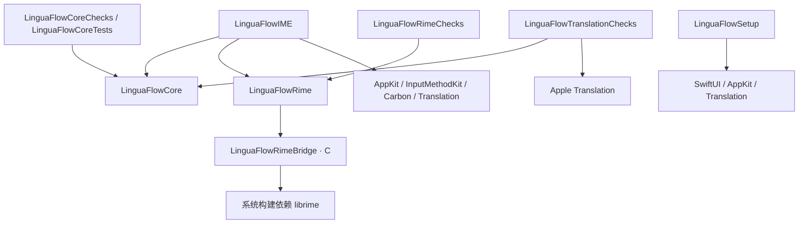
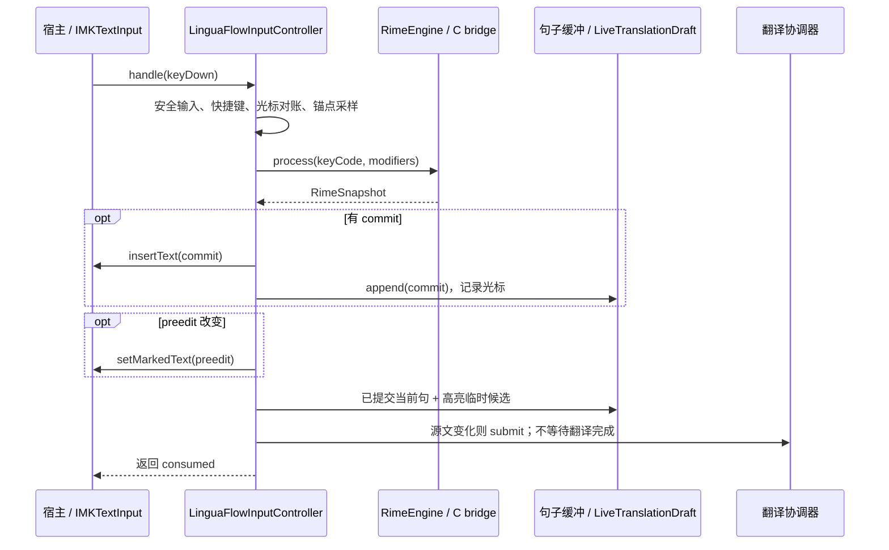

# LinguaFlow 架构与数据流

本文描述当前仓库的实际结构，供开发和代码审查使用。调查基线为 `48a2171`，整理日期为 2026-10-29；结论来自源码、配置、检查程序和打包脚本的静态核对，不代表本次已构建、安装或通过宿主兼容性测试。

[AGENTS.md](AGENTS.md) 定义必须遵守的开发约束，[需求与待办](docs/需求与待办.md) 定义已确认的首版目标。本文解释现有实现；目标与实现的差异集中列在末尾。修改模块依赖、数据流、生命周期或安装身份时同步维护本文。

## 1. 系统边界

LinguaFlow 是 macOS 原生输入法，使用 InputMethodKit 接收宿主的按键和文本输入回调，通过 librime 生成中文候选，通过 Apple Translation 生成设备端翻译。它不是读取任意应用全文的辅助功能工具，也不是翻译代理服务。

核心路径分成两条：

- **输入路径**：同步处理按键、Rime 组词和中文上屏，不等待翻译任务完成。
- **预览路径**：从当前会话缓冲及临时候选构造翻译源，防抖后异步翻译，验旧后更新独立浮层。

当前代码仍有中文、English 两套输入源。首版产品目标是只保留中文输入及当前句英文预览，并通过明确快捷键原位替换当前句；这项范围调整尚未完成。

## 2. Swift Package 与模块职责

仓库是一个 [Swift Package](Package.swift)，包含多个 target，并非每个 `Sources/` 子目录都是独立包。工具版本为 Swift 6.0，源码语言模式为 Swift 5，最低系统声明为 macOS 26。构建配置含 `/opt/homebrew/opt/librime` 头文件和链接路径；安装包脚本固定面向 arm64。

下图箭头表示静态依赖，不表示进程间通信：



| 模块／目录 | 当前职责与边界 |
| --- | --- |
| [LinguaFlowCore](Sources/LinguaFlowCore) | 句子缓冲、快照与修订号、翻译协议及协调器、临时候选拼接、光标对账、UTF-16 替换范围、浮层几何，以及现有英文候选交互规则。依赖 Foundation／CoreGraphics，不持有宿主客户端、Rime session 或真实翻译模型。 |
| [LinguaFlowRimeBridge](Sources/LinguaFlowRimeBridge) | 接触 `rime_api.h` 的 C 边界：全局初始化、session、键处理、commit/context 的读取与释放，向 Swift 暴露 opaque handle 和复制后的字符串。 |
| [LinguaFlowRime](Sources/LinguaFlowRime) | `@MainActor` 的 runtime／engine 封装、Swift 候选与快照、macOS 按键到 Rime 键值的转换。 |
| [LinguaFlowIME](Sources/LinguaFlowIME) | 应用入口、输入源注册、IMK 控制器、宿主文本交互、翻译 provider、共享 AppKit 浮层及现有英文拼写建议。是系统能力与核心状态的集成层。 |
| [LinguaFlowSetup](Sources/LinguaFlowSetup/LinguaFlowSetupApp.swift) | 独立 SwiftUI 设置助手，引导准备系统翻译模型并用固定句子验证双向翻译；不依赖 Core 或 Rime。 |
| [Vendor](Vendor) | 三个 Git 子模块：Rime Prelude、Luna Pinyin、Rime Essay。与 Homebrew OpenCC 数据一起准备成中文输入源资源。 |
| [Resources](Resources)、[scripts](scripts)、[installer](installer) | Bundle 身份、Rime 配置、应用组装、动态库嵌入、签名、安装包及升级注册流程。它们决定实际可运行产品，不能仅靠 Swift 编译验证。 |

## 3. 进程、对象与资源所有权

### 应用入口

[LinguaFlowApplication.swift](Sources/LinguaFlowIME/LinguaFlowApplication.swift) 的 `@main` 首先处理输入源安装／注册／启用／验证命令；普通启动则创建 accessory 模式的 `NSApplication`。应用 delegate 持有 `IMKServer`，从当前 Bundle 读取连接名和标识。

[InputProduct](Sources/LinguaFlowIME/InputProduct.swift) 通过 plist 的 `LinguaFlowInputMode` 选择中文或英文行为。打包脚本将同一 `LinguaFlowIME` 可执行产物复制到两个应用中；English 副本的文件名为 `LinguaFlowEnglishIME`。这是两个应用入口，不是在同一个控制器里动态切换语言。

| 对象 | 所有权／寿命 | 重要约束 |
| --- | --- | --- |
| `AppEnvironment.shared` → `RimeRuntime` | 中文输入法进程级，由应用启动创建 | librime 全局状态不能随输入控制器重建。英文模式不初始化 Rime。 |
| `LinguaFlowInputController` → `RimeEngine` | 每个中文 IMK 控制器创建一个 engine，engine 持有一个 session | 停用时清组词，engine 析构时销毁 session；不能共用一个 session 处理不同输入会话。 |
| controller → `CommittedSentenceBuffer`、候选、修订号、宿主光标位置 | 控制器级 | 不从宿主文档历史恢复句子，失效时清空。 |
| controller → `TranslationCoordinator` → `OnDeviceTranslationProvider` | 每个控制器独立的翻译状态 | 协调器在 MainActor；provider 是 actor，持有可重建的系统 TranslationSession。 |
| `PreviewPanelController.shared` → `NSPanel`／`PreviewView` | 输入法进程级共享 | 用 `ObjectIdentifier(owner)` 控制 show/hide 的会话归属，避免旧控制器隐藏新控制器的面板。 |
| `LinguaFlowSetup.app` | 输入法外的独立助手进程 | 每个输入源 Bundle 都内嵌助手副本；模型由系统管理，不通过自定义 IPC 把输入原句发给助手。 |

`RimeRuntime` 的 Swift 静态标记与 C 桥的 `g_initialized` 保证初始化只进行一次。C 接口虽然提供 `lf_rime_finalize`，当前 Swift 应用没有调用它；不要将逐 session 销毁描述成全局 runtime 的关闭。

### C 内存边界

[C 桥](Sources/LinguaFlowRimeBridge/LinguaFlowRimeBridge.c) 在 `get_commit`／`get_context` 后，将需要的 UTF-8 字符串复制到自有内存，随后在 C 内配对调用 librime 的 `free_commit`／`free_context`。Swift 不持有 librime 内部结构指针。

[RimeEngine.snapshot](Sources/LinguaFlowRime/RimeEngine.swift) 将桥接字符串转换成 Swift 值，并通过 `defer { lf_rime_string_free(...) }` 释放复制内存。`LFRimeSession` 的创建／释放也由 C 桥负责。每次引擎处理后得到 `RimeSnapshot`：`consumed`、`preedit`、候选、高亮索引及可选 commit。

## 4. 中文输入路径



具体入口为 [LinguaFlowInputController.handle／apply](Sources/LinguaFlowIME/LinguaFlowInputController.swift)：

1. 只处理 `keyDown`。安全输入时清内部上下文并返回 `false`；Command 或 Option 组合先提交现有组词，再清上下文并返回 `false`，把快捷键交给宿主。
2. 将当前选区与记录的句尾位置对账，并采样浮层锚点。已有组词时，光标对账函数让 Rime 继续管理组词内部位置。
3. 特殊键映射为 Rime 键值；普通 ASCII 键由 [RimeKeyboardMapper](Sources/LinguaFlowRime/RimeKeyboardMapper.swift) 处理。Shift 标点使用实际字符，例如 `?`，避免错误传递未修饰的 `/`。
4. Rime 返回 commit 时先向宿主上屏，再将提交内容追加到缓冲；preedit 更新则通过 `setMarkedText` 更新宿主组词区。候选和高亮项交给自绘浮层，不使用 IMK 默认候选窗口，`candidates()` 返回空数组。
5. Rime 未消费的普通 Backspace 同步缩短缓冲，并返回未消费，让宿主执行真实删除；未消费的导航键、Escape 或 Control 编辑操作清上下文。Forward Delete 单独提交组词、清上下文后透传。

`RimeRuntime` 初始化时可能同步执行词库 maintenance 并等待完成；“输入不等待翻译”不意味着 Rime 启动部署或同步宿主调用没有成本。

## 5. 当前句、临时候选与翻译路径

### 三种状态不要混为一谈

| 状态 | 来源 | 用途 |
| --- | --- | --- |
| `CommittedSentenceBuffer` | 中文路径中 Rime 已提交给宿主的 commit | 当前句与退格同步；不是整个输入框文本。 |
| `currentPreedit`／高亮候选 | Rime 正在进行的组词 | 宿主 marked text 和浮层候选；尚未上屏。 |
| `translationSourceText` | [LiveTranslationDraft](Sources/LinguaFlowCore/LiveTranslationDraft.swift) 的计算结果 | 翻译源可能包含未上屏高亮候选，不等同于缓冲原文或一个已验证的宿主替换范围。 |

当前 [CommittedSentenceBuffer](Sources/LinguaFlowCore/CommittedSentenceBuffer.swift) 按提交块追加，检查最终字符是否属于 `。！？.!?\n` 来标记句末；下一次追加有效内容时清掉上一句。它不会把一个提交块里的多个句子逐一拆分。当前超过 280 个 Swift `Character` 时仅保留尾部，而不是停止翻译并提示过长。

若有高亮临时候选且上一句未结束，`LiveTranslationDraft` 返回“已提交内容 + 候选”；若上一句已结束，则只用新候选，不带上上一句。没有候选时返回缓冲快照。候选拼接后的翻译源没有另外执行 280 字限制。

### 防抖与结果验旧

`updateTranslationDraftAndPanel` 只在翻译源字符串变化时清掉旧译文，推进 controller 的 `translationRevision`，设为 loading，并提交快照。它使用独立的翻译修订号，不直接复用句子缓冲的 `revision`：即使尚无 commit，候选变化也需要让旧翻译失效。

[TranslationCoordinator](Sources/LinguaFlowCore/TranslationCoordinator.swift) 的 `submit` 取消旧任务、记录有效 revision，然后创建异步任务：

```text
源文变化 → 取消上一任务 → 等待 400ms → provider.translate
        → 检查 Task 取消状态 → 检查协调器有效 revision
        → controller 再检查 revision 与 sourceText → 更新浮层
```

`cancel()` 使有效 revision 失效、取消任务，并异步通知 provider 取消 session。取消不是唯一防线：即使系统翻译稍后才结束，结果仍需通过协调器和 controller 的验旧检查。错误回调也先在协调器检查 revision，再显示错误信息。

[OnDeviceTranslationProvider](Sources/LinguaFlowIME/OnDeviceTranslationProvider.swift) 按方向创建已安装语言对的 `TranslationSession`，复用 session，并检查 `isReady`。macOS 26.4 及以上选择 `.lowLatency` 策略；较早版本使用基础构造方式。未安装模型映射为用户可读错误；无法导入 Translation framework 时提供抛错的降级实现。输入 provider 不主动调用 `prepareTranslation()` 下载模型。

### 当前主动插译行为

现有 `Control + Return` 分支仍是 `insertText(prefix + translatedText, replacementRange: NSNotFound)`：普通前缀为空格，带 Shift 的前缀为换行。它不计算中文整句范围，中文模式也未在该分支排除进行中的组词；首版需要的可靠整句替换尚未实现。浮层中的快捷键提示同样仍描述插入行为。

## 6. 宿主编辑、生命周期和浮层

### 光标追踪与上下文失效

`expectedHostCaretLocation` 记录已追踪句尾。中文 commit 后读取宿主 `selectedRange()`；普通尾部退格按最后一个 Swift `Character` 的 UTF-16 长度修正预期位置。宿主范围一律是 UTF-16，不能拿 `String.count` 直接替代。

[TrackedCaretReconciliation](Sources/LinguaFlowCore/TrackedCaretReconciliation.swift) 在无组词、存在上下文时，要求宿主提供有效、无选区且与预期相同的位置，否则清空。当前不是全文对账：即使位置相同，也不意味着任意宿主修改已被识别。英文局部替换路径才额外读取受追踪范围的 substring 做内容比对。

`clearDocumentContext()` 清 Rime 组词、本地候选、英文缓存和翻译上下文，隐藏归属于本控制器的浮层并丢弃锚点；`clearTranslationContext()` 重置缓冲、最新译文、源文和预期光标，推进修订号、取消翻译及拼写任务。

`deactivateServer` 当前先调用 `commitComposition`，再清上下文、隐藏面板、释放 activeClient 引用。安全输入在 `handle` 收到按键时检查；代码没有独立轮询或通知订阅来即时捕捉所有焦点、滚动和鼠标编辑。`clearDocumentContext()` 本身也没有调用宿主 `setMarkedText` 清标记；不能仅凭该方法名断言所有清理场景已满足“宿主无 marked text”的约束，需逐路径验证。

### 浮层所有权与坐标

[PreviewPanelController](Sources/LinguaFlowIME/PreviewPanelController.swift) 使用不激活宿主焦点的 `NSPanel`，忽略鼠标事件，通过 `PreviewView` 自绘拼音／源文、最多 5 个候选、译文／状态及现有英文纠错。候选暂时依赖键盘选择。

几何算法 [UnifiedPanelLayout](Sources/LinguaFlowCore/LiveTranslationDraft.swift) 放在 Core 中供检查程序测试：宽度限制为 220–440 点，优先在锚点下方显示，空间不足时翻到上方，并约束在目标屏幕的 `visibleFrame` 内。窗口层级按宿主窗口层级加一设置。

当前 `captureCaretAnchor()` 的候选顺序是：字符索引 0 的 `lineHeightRectangle` 在前，再追加当前 selected／marked range 末尾的 `firstRect`。有组词时先 marked range，否则先 selected range。`firstUsableAnchor` 选第一个几何有效、原点落在屏幕内的矩形；若本轮全无有效矩形，当前代码仍保留旧 `lastValidAnchor`。定位采样发生在按键处理时，异步翻译返回主要复用缓存锚点；尚无单独跟踪窗口移动和滚动的机制。

## 7. 现有 English 分支

英文模式复用 IMK 控制器、句子缓冲、协调器和浮层，但不走 Rime。普通英文按键返回 `false`，由宿主实际输入；控制器根据按键字符累计缓冲并预测新的 UTF-16 光标位置，因此依赖后续事件对账，并非每次都读取宿主确认结果。

- [EnglishSpellChecker](Sources/LinguaFlowIME/EnglishSpellChecker.swift) 调用 `NSSpellChecker` 的英文补全／纠错，词长至少 2，最多 5 个候选；候选生成在 MainActor 上同步执行，不应把全部英文辅助处理都称为后台异步。
- 候选中文释义由第二个翻译 provider 以 120ms 防抖批量生成，受 `candidateMeaningRevision` 和当前候选列表检查保护，结果仅缓存于内存。
- 全句拼写检查另有 400ms 防抖与 `spellCheckRevision`。方向键移动高亮，Tab 或数字接受候选，空格保留原词。
- [TrackedTextReplacement](Sources/LinguaFlowCore/TrackedTextReplacement.swift) 根据句尾和缓冲的 UTF-16 长度映射局部范围；控制器在替换前比较宿主对应 substring，再用指定 `replacementRange` 更新宿主及缓冲。该辅助函数不是已实现的中文整句替换功能。

英文能力不是已确认首版范围，但移除时要同时核对 `InputProduct`、分支状态、plist、打包、安装注册及检查脚本，不能只隐藏界面。

## 8. 模型准备、数据和隐私边界

输入法菜单通过 `NSWorkspace` 打开 Bundle 内的设置助手。[助手](Sources/LinguaFlowSetup/LinguaFlowSetupApp.swift) 只有在用户点击“准备本地翻译”后，才通过 SwiftUI `translationTask` 调用 `prepareTranslation()`，随后翻译固定中英句子显示就绪状态；关闭最后窗口后退出。

| 数据 | 当前保存位置／管理者 |
| --- | --- |
| 原句缓冲、临时候选、译文、英文释义缓存 | 控制器／浮层／任务内存；当前自有输入与翻译代码没有将其作为历史记录落盘。 |
| Rime 共享方案、词典、OpenCC 数据 | 中文 Bundle 的 `Contents/Resources/Rime/`；构建时从子模块及 OpenCC 准备。 |
| Rime 用户数据／词频学习 | `~/Library/Application Support/LinguaFlow/Rime/`，由 `AppEnvironment` 配置给 librime。不能将“不保存翻译历史”理解成完全不写磁盘。 |
| 翻译模型 | Apple Translation 系统管理；不放入 Git 或应用词库目录。 |
| 升级备份 | 用户 Application Support 下的 LinguaFlow 输入法备份目录；由安装脚本处理。 |

当前没有第三方翻译 API 或云 provider。这里描述已读代码的设计边界，不是流量、系统服务行为或供应链的完整审计。诊断日志不得为了排查问题加入用户原句和译文。

## 9. 构建、打包与系统注册

[build-app.sh](scripts/build-app.sh) 先构建 `LinguaFlowIME` 和 `LinguaFlowSetup`，再组装：

```text
.build/LinguaFlow.app/
  Contents/Info.plist
  Contents/MacOS/LinguaFlowIME
  Contents/Frameworks/*.dylib
  Contents/Resources/Rime/                 # 中文方案、词典和 OpenCC
  Contents/Resources/ThirdPartyLicenses/
  Contents/Helpers/LinguaFlowSetup.app/

.build/LinguaFlowEnglish.app/              # 同一 IME 产物，不同 plist／可执行文件名
  Contents/MacOS/LinguaFlowEnglishIME
  Contents/Frameworks/*.dylib
  Contents/Helpers/LinguaFlowSetup.app/
```

[prepare-rime-data.sh](scripts/prepare-rime-data.sh) 复制三个子模块的数据与 [default.custom.yaml](Resources/Rime/default.custom.yaml)，仅暴露 `luna_pinyin_simp`，候选页大小为 5；复制并验证 schema 使用的 OpenCC 配置和字典。

[embed-rime-runtime.sh](scripts/embed-rime-runtime.sh) 递归收集非系统绝对路径依赖，复制到 `Frameworks`，改写为 `@rpath`，移除外部搜索路径。随后按 dylib → helper → 外层应用的顺序签名并验证。当前英文 Bundle 虽然运行时不使用 Rime，仍包含相同二进制链接所需的运行库。

| 运行入口 | 目标／限制 |
| --- | --- |
| [install-local.sh](scripts/install-local.sh) | 构建后复制两套应用到 `~/Library/Input Methods`，终止旧进程并注册。沿用上游身份，不是已隔离的开发版安装器。 |
| [build-installer.sh](scripts/build-installer.sh) | 构建 arm64 `.pkg` 到 `.build/dist/`，将两套应用固定到 `/Library/Input Methods`，禁止可重定位 Bundle，检查依赖、OpenCC、签名和安装包结构。 |
| [preinstall](installer/scripts/preinstall)、[postinstall](installer/scripts/postinstall) | 停止旧进程，按精确路径／身份迁移当前用户旧副本为禁用备份，注册并启用系统副本，进行有界重试和新进程验证。会话注册最终仍可能延后到下次登录，postinstall 对这一情况给出提示并返回成功。 |
| [check-installed-input-sources.swift](scripts/check-installed-input-sources.swift) | 单独检查两套上游 ID、版本、启用／可选状态，以及 LaunchServices 是否解析到系统路径；不适用于未经适配的单中文隔离身份。 |

当前中文 Bundle／输入源 ID 是 `com.fufangjie.inputmethod.LinguaFlow`，English 为 `com.fufangjie.inputmethod.LinguaFlowEnglish`。身份还存在于 [plist](Resources/Info.plist)、[英文 plist](Resources/English-Info.plist)、应用注册白名单和脚本中；只修改一份 plist 不足以实现共存。

未提供证书时应用采用 ad-hoc 签名，安装包未签名。脚本支持通过 `CODE_SIGN_IDENTITY`、`INSTALLER_SIGN_IDENTITY`、`NOTARYTOOL_PROFILE` 执行正式签名和公证；完成可选公证／staple 后再生成 SHA-256。许可证和上游声明随 Bundle／安装包保留，具体见 [THIRD_PARTY_NOTICES.md](THIRD_PARTY_NOTICES.md)。

## 10. 验证层与修改入口

| 验证层 | 现有入口 | 能证明与不能证明的内容 |
| --- | --- | --- |
| 核心自检 | [LinguaFlowCoreChecks](Sources/LinguaFlowCoreChecks/main.swift) | 当前缓冲／退格、光标对账、英文局部替换与候选规则、翻译成功回调、临时候选、浮层几何；不模拟真实 IMK 宿主。 |
| XCTest | [CoreTests](Tests/LinguaFlowCoreTests) | 缓冲行为、可控 provider 下的新旧 revision 及取消后晚返回。与核心自检不是完全相同覆盖；运行环境是否可用需当次确认。 |
| 真实 Rime | [LinguaFlowRimeChecks](Sources/LinguaFlowRimeChecks/main.swift) | 使用真实 runtime／临时用户目录检查 OpenCC 资源、Shift 标点、拼音候选及上屏；`ceshi` 要求含“测试”，`nihao` 上屏只断言非空，不是固定文本断言。 |
| 真实模型 | [LinguaFlowTranslationChecks](Sources/LinguaFlowTranslationChecks/main.swift) | Apple 固定句子的双向翻译冒烟；模型未安装返回 2，不证明翻译延迟、任意措辞质量或最新状态验旧。 |
| 编译／应用／安装包 | `swift build` 及构建脚本 | 分别验证编译、Bundle 和分发结构；不证明当前会话实际加载了该构建。 |
| 真实宿主 | [需求验收表](docs/需求与待办.md)、[宿主验收技能](.agents/skills/linguaflow-host-validation/SKILL.md) | 文本编辑和 Codex 分别实测输入、定位、生命周期与替换，不从其他层的通过推断兼容性。 |

改分句、字符范围或取消逻辑时，先在 Core 增加失败检查，再修改集成代码；改 Rime 行为还要看桥接与真实引擎检查；改浮层要同时区分几何算法与宿主锚点采样；改安装身份要覆盖资源、注册和脚本。构建与检查命令以 [README](README.md) 及 [项目技能](.agents/skills) 为入口，不引入 Playbook 或 Nodus 作为前置条件。

## 11. 与已确认首版目标的差异

以下是待实现／待验证项，不是本文已完成的功能：

| 首版目标 | 当前代码状态 |
| --- | --- |
| 仅中文输入源 | 英文输入源、纠错、反向预览、双 Bundle 与双输入源注册仍在。 |
| 按约定边界预览当前整句 | 缓冲按提交块尾字符判断，仍把英文句点视为句末；中文换行依赖 Rime 返回内容，没有独立保证每个宿主换行都形成缓冲边界。 |
| 超过 280 字明确降级 | 当前截尾，候选拼接也没有统一的总长度保护。 |
| `Control + Return` 原位替换当前中文句 | 当前是前缀空格／换行追加译文，没有完整的中文句范围确认、组词中拒绝及替换后状态清理流程。 |
| 优先当前光标，失去位置则隐藏 | 字符索引 0 的矩形仍优先，无新有效锚点时可能复用旧位置，窗口移动／滚动缺少独立更新机制。 |
| 可靠处理失焦、安全输入及编辑后的清理 | 已有停用和按键时检查，但即时事件覆盖、宿主 marked text 清理及鼠标修改后的范围可靠性仍需实测。 |
| 隔离开发版、文本编辑与 Codex 验收 | 当前身份沿用上游；需求文档未记录完成隔离安装及这两个宿主的首版验收，不能宣称已兼容。 |

后续实现以需求文档为准；完成后同时更新本表、相关实现说明和实际验证记录，不将“计划采用的结构”提前写成现有事实。
